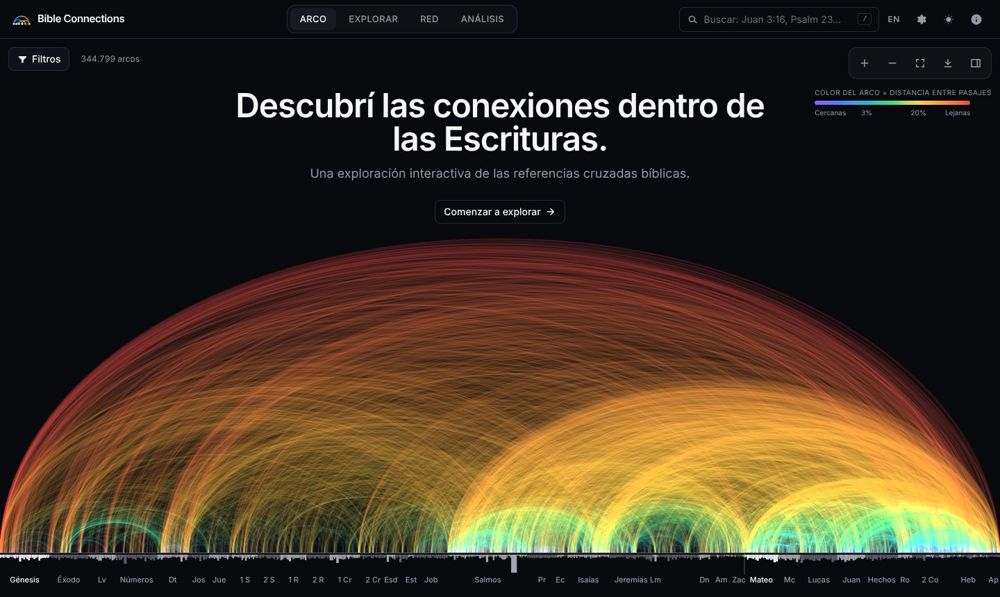
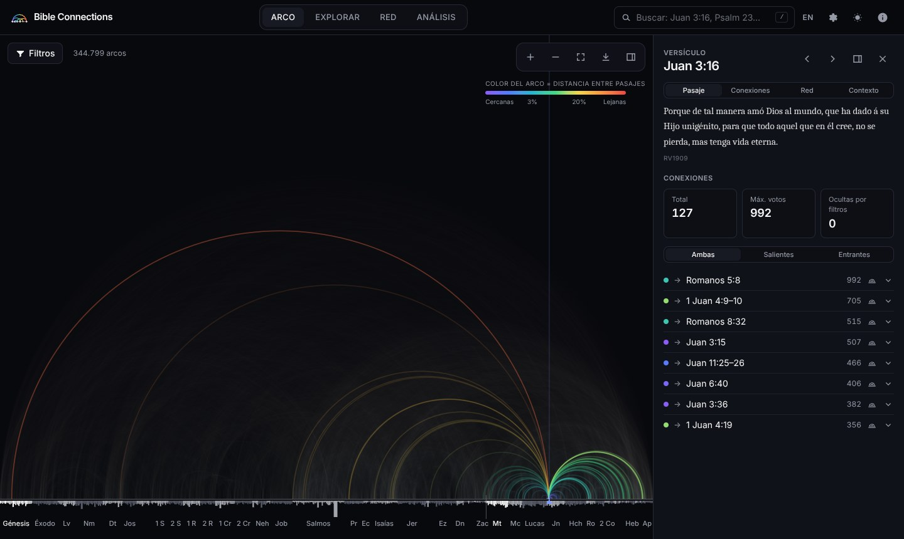
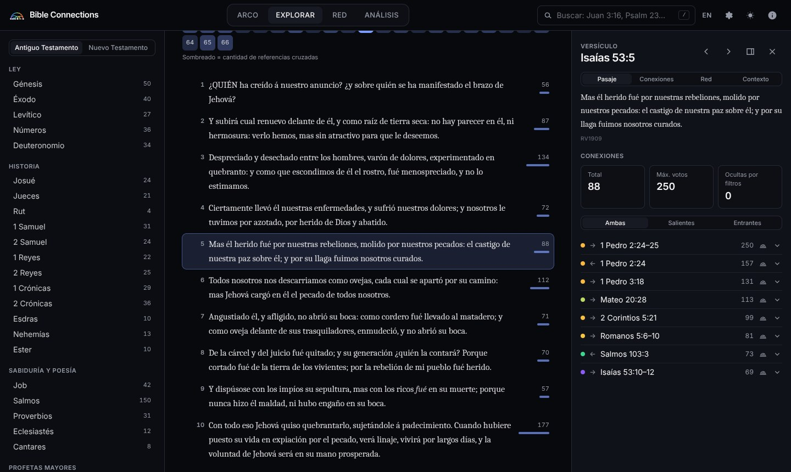
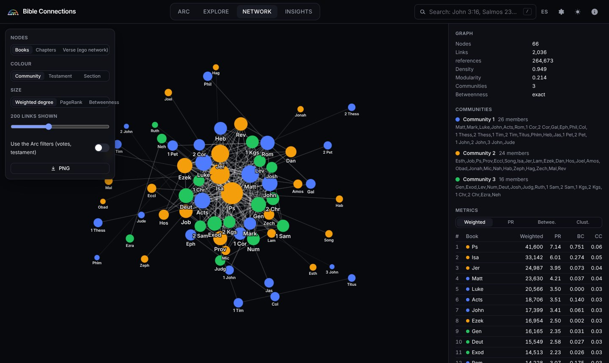
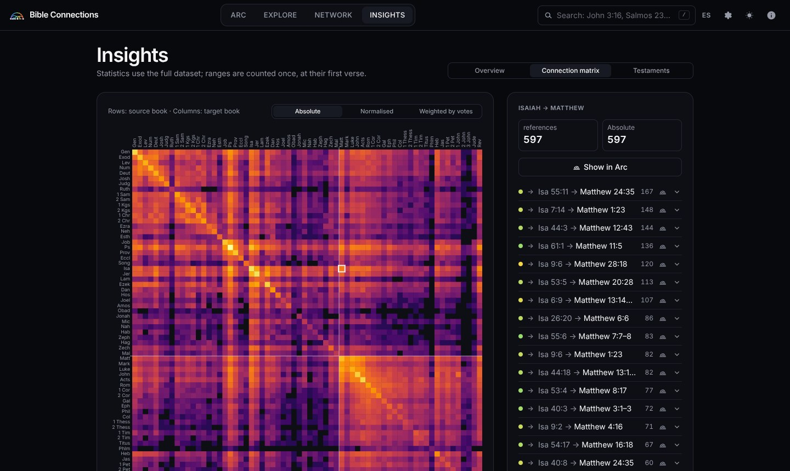
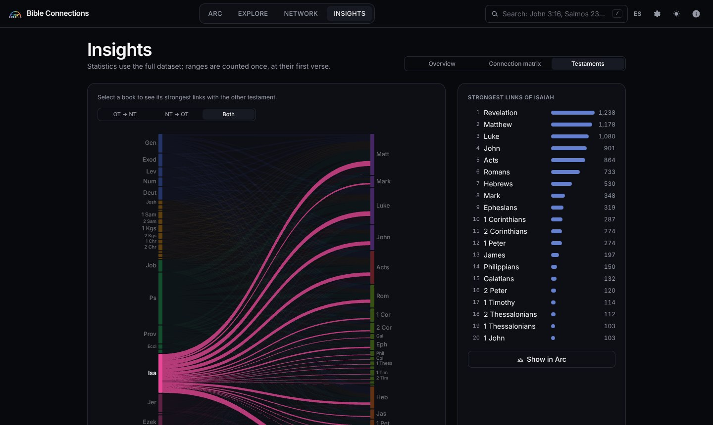
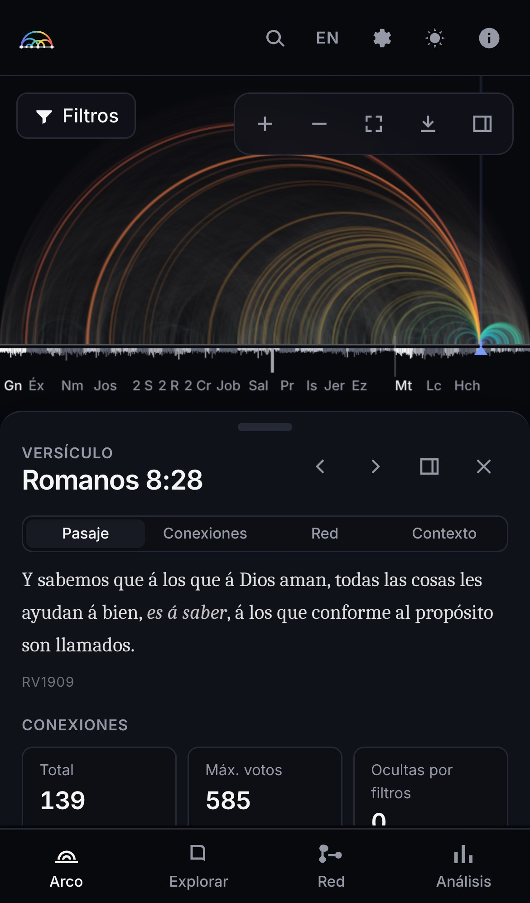
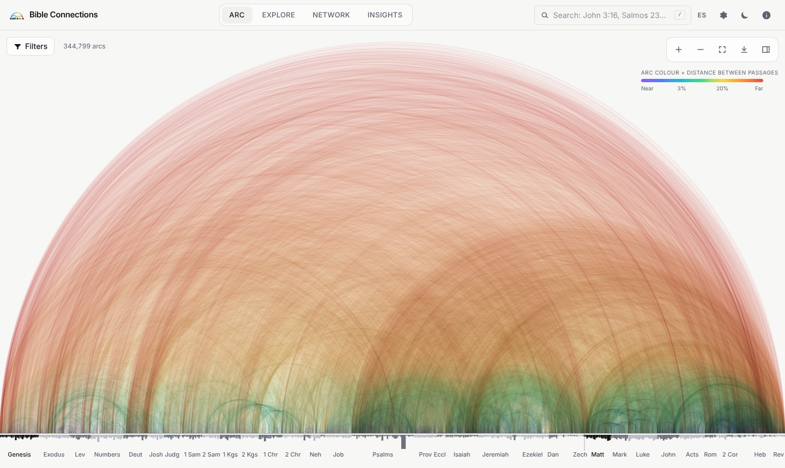

<p align="center">
  
</p>

<h1 align="center">Bible Connections</h1>

<p align="center"><em>Discover the connections within Scripture.</em><br>
An interactive exploration of biblical cross-references.</p>

<p align="center">
  
</p>

**Bible Connections** es una plataforma web interactiva para explorar las **344.799 referencias
cruzadas** del conjunto de datos de [OpenBible.info](https://www.openbible.info/labs/cross-references/).
Cada referencia es un arco que une dos pasajes sobre una línea que representa toda la Biblia;
el color indica la distancia entre ellos. A partir de esa vista global se puede acercar hasta un
versículo, leer los textos (Reina-Valera 1909 o World English Bible), recorrer las conexiones,
analizar la red de libros y capítulos y estudiar estadísticas.

La visualización se inspira en el gráfico de referencias cruzadas de **Chris Harrison y
Christoph Römhild (2007)**. Es una obra independiente: no es una reproducción oficial ni está
afiliada a sus autores.

> *English summary:* a static React + WebGL web app that draws every OpenBible.info
> cross-reference as an arc (Harrison & Römhild style), with zoom down to single verses,
> bilingual search (Spanish/English), public-domain Bible texts, network analysis (PageRank,
> betweenness, Louvain communities), statistics and exports. It runs entirely on GitHub Pages.

---

## Contenido

1. [Capturas](#capturas)
2. [Características](#características)
3. [Arquitectura](#arquitectura)
4. [Tecnologías](#tecnologías)
5. [Instalación y desarrollo local](#instalación-y-desarrollo-local)
6. [Importación de datos](#importación-de-datos)
7. [Las referencias cruzadas: modelo y decisiones](#las-referencias-cruzadas-modelo-y-decisiones)
8. [Pruebas](#pruebas)
9. [Rendimiento](#rendimiento)
10. [Publicación en GitHub Pages](#publicación-en-github-pages)
11. [Licencias y atribuciones](#licencias-y-atribuciones)
12. [Limitaciones conocidas](#limitaciones-conocidas)

## Capturas

| | |
|---|---|
|  |  |
| **Arco** — Juan 3:16 y sus 127 conexiones, con el texto RV1909 | **Explorar** — lectura por capítulo con densidad de referencias |
|  |  |
| **Red** — 66 libros, comunidades Louvain, PageRank | **Análisis** — matriz 66 × 66 con detalle por celda |
|  |  |
| **Testamentos** — Isaías y sus vínculos con el NT | **Móvil** — panel inferior y gestos táctiles |
|  | |
| **Tema claro** — acumulación sustractiva ("tinta") | |

## Características

### ARC — la visualización principal
- **Las 344.799 referencias**, sin muestreo, dibujadas como semicírculos sobre una línea que
  representa toda la Biblia. Cada versículo ocupa su posición real (orden canónico protestante),
  así que cada libro y capítulo ocupa un ancho proporcional a su cantidad de versículos.
- **Color continuo por distancia**: violeta/azul (cercanas) → verde/amarillo (intermedias) →
  naranja/rojo (lejanas).
- Barras bajo el eje: un capítulo por barra, libros alternando gris claro/oscuro y el primer libro
  de cada testamento resaltado, como en el original (largo = versículos, o referencias, a elección).
- **Zoom** general, por testamento, libro, capítulo y versículo (rueda, pellizco, doble clic,
  botones, teclado `+ − 0 ← →`), con **transiciones animadas** y desplazamiento horizontal.
- **Hover**: resalta el arco, atenúa el resto y muestra origen, destino y distancia.
  **Clic en un arco**: panel con ambos textos, libros, posición relativa y conexiones
  relacionadas (recíproca, otras desde el origen, otras hacia el destino).
  **Clic en el eje**: selecciona el libro, capítulo o versículo según el nivel de zoom.
- **Selección de pasajes** (también rangos): resalta todas sus conexiones, atenúa el resto, las
  lista y permite saltar al otro extremo (y volver con *atrás*).
- Pantalla inicial con animación sutil (los arcos crecen desde el eje; se cancela al interactuar).

### Navegación y búsqueda
- Navegador **Biblia → Testamento → Libro → Capítulo → Versículo** (vista *Explorar*), con texto
  completo del capítulo y la cantidad de referencias de cada versículo.
- **Buscador bilingüe** con sugerencias: `Genesis 1:1`, `Gen 1:1`, `John 3:16`, `Juan 3:16`,
  `Salmos 23`, `Romanos 8:28`, `1 Juan 4:8`, `Sal 23:1-4`, `Gn 1,1`, `John.3.16`… (ignora tildes,
  mayúsculas y puntos). Atajos: `/` o `Ctrl/Cmd+K`.
- Navegación anterior/siguiente por versículo, capítulo o libro.
- **Estado en la URL** (`#/arc?sel=v:John.3.16&t=cross&top=10000`): vistas compartibles y
  botón *atrás* del navegador.

### Panel de exploración
Secciones **Pasaje**, **Conexiones**, **Red** y **Contexto**. Se puede ocultar; en móviles es un
panel inferior redimensionable.

### Fuentes
Cada conexión declara su procedencia (en el tooltip, el panel y las listas, con la etiqueta TSK u
OB). OpenBible.info no la indica en su archivo, así que se compara cada registro con el propio
*Treasury of Scripture Knowledge* (c. 1880, dominio público): **335.024 (97,2 %) figuran en el
TSK** y **9.775 fueron agregadas por OpenBible.info**. El filtro *Fuente* permite ver sólo las
del TSK o sólo las agregadas. Las 63.779 referencias de Harrison y Römhild (2007) no están
publicadas, por lo que no se pueden comparar. Detalle del método en `data-source/README.md`.

### Herramientas de estudio y descubrimiento
- **Camino entre dos pasajes** (Red → Camino): la cadena más corta de referencias que une dos
  versículos, con el texto de cada paso, la fuente de cada referencia y hasta dos alternativas
  que no repiten los pasos intermedios. Se puede ver dibujada en el Arco.
- **Diagrama de cuerdas** (Análisis → Cuerdas): los 66 libros en círculo; cada cinta une dos
  libros con un ancho proporcional a sus referencias.
- **Personas y lugares** (Red → Personas y lugares): red de co-apariciones en un mismo
  versículo (como la segunda visualización de Harrison), con 4.223 personas, lugares y grupos
  desambiguados de STEPBible TIPNR. Incluye buscador, red ego y la lista de versículos donde aparece
  cada nombre. Los nombres y descripciones están en inglés, como en la fuente.
- **Mi estudio**: favoritos (pasajes y conexiones) y notas por pasaje, guardados en el navegador;
  hoja de estudio imprimible o en PDF con textos, notas y principales conexiones; exportar e
  importar en JSON.

### Filtros
Fuente (todas, del TSK, agregadas por OpenBible) · Testamento (todas, AT→AT, NT→NT, AT↔NT) · uno o varios libros, con dirección *desde / hacia /
ambas* y modo *entre dos grupos de libros* ·
distancia (cercanas / intermedias / lejanas) · densidad **Top 1k / 10k / 50k / 100k / todas**.
La selección es **determinista**: los datos están ordenados por votos (desc.) y luego por posición
canónica, así que *Top N* es siempre el mismo prefijo, nunca una muestra aleatoria.

### NETWORK — explorador de redes
- Grafo de fuerzas (D3) de **66 libros** o **1.189 capítulos**, y **red ego** de un versículo.
- Métricas: grado, grado ponderado, **intermediación (Brandes)**, **PageRank**, **comunidades
  (Louvain)** y **coeficiente de agrupamiento ponderado** (Onnela et al.). Color por comunidad,
  testamento o sección; tamaño por grado ponderado, PageRank o intermediación.
- Las métricas se precalculan **exactas** en la compilación; con *"Usar los filtros del Arco"* se
  recalculan en un **Web Worker** para el subconjunto filtrado.

### INSIGHTS — estadísticas
- Indicadores: total de referencias, libros, capítulos, versículos con conexiones, promedio de
  conexiones por versículo, conexiones entre testamentos, rangos.
- Rankings de libros, capítulos y versículos más conectados.
- Distribución de distancias; alcance (mismo capítulo / libro / entre libros) y
  testamentos.
- **Matriz 66 × 66** (filas: libro de origen, columnas: destino) con escala absoluta, normalizada
  y detalle de las conexiones de cada celda.
- **Correlación de toda la Biblia**: cuadro 66 × 66 (libros), 1.189 × 1.189 (todos los
  capítulos) o versículo a versículo dentro de un libro (hasta 2.461 × 2.461 en Salmos; toda la
  Biblia por versículos serían ~967 millones de celdas, inviable en un navegador) con la r de Pearson entre perfiles de conexión (con qué libros se conecta cada
  pasaje, sin contar el propio), en orden canónico o por comunidades, con la lista de pasajes
  más parecidos. Se calcula en un Web Worker y puede usar los filtros del Arco.
- **Comparación de testamentos**: flujo AT ↔ NT (p. ej. Isaías → libros del NT; Mateo → AT).

### Otros
- **Textos bíblicos** mediante `BibleTextProvider`: Reina-Valera 1909 y World English Bible
  (ambas de dominio público), con soporte para agregar más traducciones.
- Interfaz **en español e inglés** (independiente de la traducción bíblica), tema **oscuro/claro**.
- **Exportación**: PNG (1×/2×/4×, fondo transparente, etiquetas, leyenda), SVG (hasta 20.000
  arcos), CSV y JSON de las conexiones filtradas, estadísticas agregadas (JSON). Todo refleja los
  filtros activos.
- Responsive: escritorio, portátil, tablet y teléfono; sin desbordamiento horizontal.

## Arquitectura

```text
data-source/                     Datos de origen sin modificar (+ alineaciones de versificación)
  cross_references.txt           OpenBible.info, CC BY 4.0
  texts/spaRV1909/  texts/eng-web/
scripts/                         Proceso de datos (Node 22, TypeScript sin transpilar)
  import-crossrefs.ts            parseo, validación, duplicados, binario + informe
  build-texts.ts                 textos por libro, alineados a la versificación KJV
  generate-statistics.ts         estadísticas y métricas de red exactas
  build-data.ts / ensure-data.ts orquestación (incremental) → public/data/
  validate-data.ts               verificación independiente contra el archivo original
  derive-versification.ts        tabla de capítulos/versículos (KJV) con hash de la fuente
  align-translation.ts           alineación por números Strong (RV1909 ↔ KJV)
src/
  data/        books, bibleStructure (posiciones globales), parser, format (binario),
               loader, textProvider (BibleTextProvider), search
  analysis/    filtros, anclaje de rangos, distancia, agregación, estadísticas
  graph/       PageRank, Brandes, Louvain, agrupamiento, NetworkFile
  workers/     data.worker (descarga + descompresión + decodificación),
               analysis.worker (métricas de red filtradas)
  visualizations/
    ArcVisualization/   WebGL2 + Canvas 2D, eje, interacción, exportación PNG
    NetworkExplorer/    grafo de fuerzas (Canvas + d3-force + d3-zoom)
    ConnectionMatrix/   mapa de calor 66 × 66
    TestamentComparison/ flujo AT ↔ NT
  pages/       ArcPage, ExplorePage, NetworkPage, InsightsPage
  components/  navegación, búsqueda, paneles, filtros, diálogos
  state/       store mínimo + sincronización con la URL
public/data/   (generado) binario de referencias, textos, estadísticas, manifest
tests/unit/    Vitest (datos completos)      tests/e2e/   Playwright (build de producción)
```

**Flujo de datos.** `npm run data` lee `data-source/`, valida y escribe en `public/data/`:

| Archivo | Contenido | Tamaño |
|---|---|---|
| `references/refs.<hash>.gzbin` | tabla de referencias, binario columnar comprimido | 864 KiB |
| `references/refs.<hash>.bin` | la misma tabla sin comprimir (respaldo) | 3,4 MB |
| `texts/<CÓDIGO>/<Libro>.json` + `meta.json` | textos por libro, notas de versificación, licencia | ~4 MB por traducción (gzip en Pages) |
| `statistics/*.json` | estadísticas y métricas de red | 380 KB |
| `books.json`, `chapters.json` | entidades Book y Chapter | 110 KB |
| `manifest.json`, `import-report.json` | hashes, procedencia, informe de importación | — |

En el navegador, un **Web Worker** descarga el binario (con progreso), lo descomprime con
`DecompressionStream`, lo decodifica y transfiere los arreglos sin copiarlos. Se guarda en **Cache
Storage** con nombre por hash de contenido. Las vistas *Explorar*, *Red* y *Análisis* se cargan
de forma diferida (*lazy loading*).

**Renderizado del arco.** WebGL2 con *instancing*: cada referencia ocupa 16 bytes en la GPU
(origen, destino, color, peso) y el semicírculo se calcula en el *vertex shader*, así que el zoom
no toca la CPU. Los arcos se agrupan por distancia y cada grupo usa entre 8 y 128 segmentos según
su tamaño en pantalla (nivel de detalle). La capa base se **acumula en un framebuffer de media
precisión** y se aplica un **mapeo tonal logarítmico que conserva el tono**, para que 345.000
arcos superpuestos no se saturen en blanco (en tema claro se acumula "tinta" sustractiva).
Durante la interacción: *frame pacing* con `fenceSync` (nunca se encolan cuadros si la GPU está
ocupada), nivel de detalle adaptativo (dibuja primero los arcos más votados) y media resolución en
pantallas HiDPI. Si no hay WebGL2, un renderizador **Canvas 2D progresivo** (por lotes de color y
en porciones de 12 ms) mantiene la interfaz fluida. El eje, etiquetas y marcadores se dibujan en
un canvas 2D superpuesto con nivel de detalle (libros → capítulos → versículos).

## Tecnologías

React 19 · TypeScript 6 · Vite 8 · Tailwind CSS 4 (variables CSS para temas) · D3 7 (escalas,
interpolaciones, fuerzas, zoom) · WebGL2 / Canvas 2D / SVG · Web Workers · Vitest · Playwright ·
fuente Inter (incluida localmente, sin servidores externos).

## Instalación y desarrollo local

Requisitos: **Node.js ≥ 22.18** (ejecuta los scripts `.ts` directamente) y npm.

```bash
git clone https://github.com/juanmarcosmoreno-arch/Bible_Connections.git
cd Bible_Connections
npm ci
npm run dev        # genera public/data si hace falta y abre http://localhost:5173
```

| Comando | Qué hace |
|---|---|
| `npm run data` | importa y regenera todo `public/data/` (~8 s) |
| `npm run data:validate` | verifica los datos generados contra `cross_references.txt` |
| `npm run typecheck` | comprobación de tipos (app, scripts y pruebas) |
| `npm test` | pruebas unitarias (Vitest, datos completos) |
| `npm run build` | compilación de producción en `dist/` |
| `npm run preview` | sirve `dist/` en `http://localhost:4173/Bible_Connections/` |
| `npm run test:e2e` | pruebas end-to-end (Playwright) contra `dist/` |

`npm run dev` y `npm run build` regeneran los datos automáticamente sólo cuando cambia alguna
entrada (hash de los archivos de origen).

> Nota: `.npmrc` activa `legacy-peer-deps` por un error del resolutor de npm 10 con las
> dependencias opcionales de Vite 8; no cambia las versiones instaladas.

## Importación de datos

```bash
npm run data && npm run data:validate
```

Resultado actual (ver `public/data/import-report.json`):

| | |
|---|---|
| Líneas de datos en `cross_references.txt` | 344.799 |
| Referencias importadas | **344.799** |
| Registros inválidos | 0 |
| Registros duplicados (mismo origen y destino) | 0 |
| Destinos que son rangos | 88.150 (655 cruzan capítulos, 18 cruzan libros) |
| Votos | mínimo −86, máximo 1.317, mediana 3; 1.217 negativos, 2.227 en cero |
| Verificación de ida y vuelta | 344.799 identificadores reconstruidos sin diferencias |

El importador reconoce libros, capítulos, versículos y rangos (incluidas formas cortas como
`Gen.1.1-3`), conserva el identificador original y los votos, detecta duplicados y registra cada
error con su número de línea. `validate-data.ts` vuelve a leer el archivo original de forma
independiente y comprueba que cada registro está en el binario exactamente una vez.

Para agregar una traducción: colocar `xxx_vpl.txt` (formato VPL de eBible.org) y un
`translation.json` en `data-source/texts/<id>/`, verificar su licencia y, si su versificación
difiere de la KJV, generar `alignment.json` con `node scripts/align-translation.ts <id>` (requiere
la edición USFM con números Strong) o escribir las correspondencias a mano.

## Las referencias cruzadas: modelo y decisiones

**Entidades.** `Book` (id, code, name, testament, order, chapterCount, …), `Chapter` (id, bookId,
number, verseCount, globalPosition), `Verse` (id, bookId, chapter, verse, globalPosition) y
`CrossReference` (source, target, votes, sourceRange, targetRange, sourcePosition,
targetPosition, distance…), en `src/data/`.

**Versificación.** Los versículos se ubican con la tabla de la **King James Version** (66 libros,
1.189 capítulos, 31.102 versículos), derivada de eBible.org con su hash SHA-256 y verificada contra
la RV1909. OpenBible.info usa numeración tipo ESV en un solo caso: **3 Juan 1:15** (5 registros),
que en la KJV y la RV1909 forma parte de 1:14; se agrega como posición adicional (31.103 en total)
y en el texto se muestra 1:14 con una nota. Las traducciones no comparten siempre la misma
división: la edición RV1909 de eBible.org conserva cortes de capítulo hebreos (Números 12/13 y
29/30, 1 Samuel 23/24, Job 38–41, Oseas 11/12, Jonás 1/2…) dentro de un esquema de 31.102
versículos, lo que desplaza el texto de capítulos enteros. Esos 215 versículos se **alinean** a la
numeración KJV comparando los números Strong de ambas ediciones; cuando un versículo de la RV1909
abarca varios de la KJV se indica. Ningún texto se inventa ni se parafrasea.

**Rangos y regla de anclaje.** Los rangos se conservan completos en los datos y nunca se expanden
en varias conexiones. Para dibujar un arco se usa un único punto: por defecto el **primer
versículo** del rango (configurable: primero, centro o último, en *Configuración*). Al seleccionar
un versículo, una referencia cuenta si el versículo está **dentro** del rango.

**Distancia y color.** Distancia = |posición destino − posición origen| / total de versículos.
Clases: cercana ≤ 3 %, intermedia ≤ 20 %, lejana > 20 % (≈ terciles del conjunto: 33 % ≈ 0,035;
66 % ≈ 0,20). La escala de color es continua y lineal por tramos sobre esos cortes, interpolada en
CIELAB.

**Votos.** El archivo de OpenBible incluye votos de sus usuarios. Se conservan intactos en los
datos (por fidelidad), pero la interfaz no los muestra ni los usa como filtro. Internamente sólo
determinan el orden estable de la tabla (que define *Top N*) y la intensidad relativa de cada arco.

**Normalizaciones de la matriz.** *Absoluta*: cantidad de referencias del libro fila al libro
columna. *Normalizada*: cantidad ÷ (versículos del libro fila × versículos del libro columna) ×
10⁶ (referencias por millón de pares posibles).

**Redes.** Las aristas agregan las referencias entre nodos (anclando cada rango en su primer
versículo); los autoenlaces se cuentan aparte. Intermediación: Brandes con longitud = 1/peso,
exacta para libros y capítulos en la compilación; en el navegador, para capítulos filtrados, se
estima con 128 pivotes (Brandes–Pich). PageRank: dirigido y ponderado, amortiguación 0,85.
Comunidades: Louvain (modularidad, resolución 1, orden determinista). Con todos los datos, los 66
libros forman 3 comunidades: Nuevo Testamento; Sabiduría, Profetas y Apocalipsis; Ley e Historia
(Q = 0,214). Los capítulos forman 6 (Q = 0,331). No se ejecutan algoritmos cuadráticos sobre los
31.103 versículos: la red de versículos se explora como red ego.

## Pruebas

- **Unitarias (Vitest, 83 pruebas, ~6 s)** sobre la base completa: parseo de referencias y rangos,
  validación de libros, posiciones globales, formato binario, importación sin pérdidas (cada línea
  del archivo original presente exactamente una vez), integridad referencial, filtros por
  testamento y libro, votos negativos, clases de distancia, Top N determinista, grados por
  versículo con rangos, búsqueda bilingüe, PageRank / Brandes / Louvain / agrupamiento,
  estadísticas, textos y alineación, procedencia (parser del TSK y casos verificados a mano),
  estado en la URL, geometría y exportaciones.
- **End-to-end (Playwright, 21 pruebas, ~1,5 min)** contra el build de producción servido bajo
  `/Bible_Connections/`: carga y dibujo de los 344.799 arcos (análisis de píxeles), pantalla
  inicial, búsqueda "Juan 3:16", hover y clic en arcos, selección en el eje, filtros, zoom, estado
  en la URL y *atrás*, exportación CSV y PNG, Explorar, Red (incluido el recálculo en el worker),
  Análisis, idioma y tema, rendimiento con la base completa, y en móvil: ausencia de
  desbordamiento horizontal y panel inferior.
- `npm run data:validate`: 10 comprobaciones independientes de los datos generados.

## Rendimiento

Medido con la base completa (344.799 referencias) en Chromium sin interfaz, con el build de
producción servido localmente (`tests/e2e/perf.spec.ts` imprime estas cifras en cada ejecución).
El entorno de pruebas **no tiene GPU**: WebGL se ejecuta en la CPU (SwiftShader), así que los
tiempos de dibujo son un límite pesimista. En una GPU real el mismo trabajo es uno o dos órdenes de
magnitud más rápido; esa medición no se pudo hacer aquí.

| Medida | Resultado |
|---|---|
| Descarga + descompresión + decodificación de la tabla (worker) | 130–610 ms |
| Datos listos desde la navegación | ≈ 0,3–0,6 s |
| Memoria JS tras la carga | ≈ 28 MB |
| Cambio de filtro (clic → arcos y contador actualizados) | 75–85 ms |
| Cuadro de GPU durante la interacción / refinamiento (CPU, SwiftShader) | 30–480 ms por porción, sin bloquear la interfaz |
| Compilación de datos (`npm run data`) | ≈ 8 s |
| JavaScript inicial (gzip) | ≈ 91 KB + vistas diferidas |

Técnicas aplicadas: preprocesamiento en compilación, binario columnar con delta y gzip (864 KiB),
Web Workers (decodificación y métricas), Cache Storage, carga diferida de vistas, instancing WebGL2
con LOD por distancia, acumulación progresiva (los arcos más votados primero), *frame pacing* con
`fenceSync`, subidas a la GPU sólo cuando está libre, resolución reducida durante el zoom en
pantallas HiDPI, memoización de arreglos derivados y filtrado lineal sobre arreglos tipados.

## Publicación en GitHub Pages

El workflow `.github/workflows/deploy.yml` instala dependencias, genera y valida los datos,
comprueba tipos, ejecuta las pruebas unitarias y end-to-end, compila y publica `dist/` con
GitHub Actions. Los *pull requests* ejecutan todo salvo la publicación.

1. En GitHub: **Settings → Pages → Build and deployment → Source: GitHub Actions**.
2. Hacer *merge* a `main` (o ejecutar el workflow manualmente).
3. El sitio queda en `https://juanmarcosmoreno-arch.github.io/Bible_Connections/`.

La ruta base se toma del nombre del repositorio (`BASE_PATH=/${{ github.event.repository.name }}/`).
El repositorio se llama `Bible_Connections` (según `git remote`), y las rutas de GitHub Pages
distinguen mayúsculas, así que la base por defecto es `/Bible_Connections/`. La navegación usa
*hash routing* (`#/arc`, `#/explore`…), por lo que no hace falta `404.html` ni reescrituras, y
todos los recursos y datos se resuelven con `import.meta.env.BASE_URL`.

## Licencias y atribuciones

Las licencias del código, los datos y los textos son **independientes**:

- **Código**: MIT (`LICENSE`).
- **Personas y lugares**: datos derivados de *TIPNR — Translators Individualised Proper Names with
  all References*, STEPBible.org, basado en trabajo de Tyndale House Cambridge, **CC BY 4.0**
  (<https://github.com/STEPBible/STEPBible-Data>). Se incluye sólo un subconjunto derivado
  (nombre, tipo, descripción breve y versículos), como pide STEPBible; cambios descritos en
  `data-source/names/tipnr-derived.json`.
- **Treasury of Scripture Knowledge**: dominio público (módulo SWORD "TSK" de CrossWire), usado
  para declarar la procedencia de cada referencia.
- **Referencias cruzadas**: © OpenBible.info, **[CC BY 4.0](https://creativecommons.org/licenses/by/4.0/)**.
  *"Cross-reference data from OpenBible.info (https://www.openbible.info/labs/cross-references/),
  licensed CC BY 4.0."* Los datos derivan principalmente del *Treasury of Scripture Knowledge*
  (dominio público). Esta atribución aparece en la app (*Acerca de*), en las exportaciones y en
  `data-source/README.md`. Cambios realizados: conversión de formato y cálculo de estadísticas;
  ninguna referencia se agrega, elimina ni modifica.
- **Reina-Valera 1909**: dominio público (eBible.org, `spaRV1909`).
- **World English Bible**: dominio público; "World English Bible" es marca de eBible.org (texto
  sin modificar).
- **Tabla de versificación**: derivada de la King James Version (1769), dominio público fuera del
  Reino Unido (eBible.org `eng-kjv2006`).
- **Inspiración visual**: Chris Harrison y Christoph Römhild, *Bible Cross-References* (2007),
  <https://www.chrisharrison.net/index.php/Visualizations/BibleViz>. Bible Connections es una
  reinterpretación independiente con otro conjunto de datos (OpenBible.info en lugar de las 63.779
  referencias del original); no es una reproducción oficial.
- **Inter** (fuente): SIL Open Font License, vía `@fontsource-variable/inter`.

## Limitaciones conocidas

- Cada rango se dibuja y se agrega en un único punto de anclaje (configurable).
- En el navegador, la **intermediación por capítulos** filtrada es aproximada (128 pivotes); los
  valores precalculados sin filtros son exactos.
- La **exportación SVG** se limita a 20.000 arcos para que el archivo sea utilizable; PNG no tiene
  ese límite.
- Requiere un navegador moderno (WebGL2 recomendado; `DecompressionStream`: Chrome 80+, Firefox
  113+, Safari 16.4+; si falta, se descarga la versión sin comprimir).
- En equipos sin GPU (renderizado por software) el dibujo completo puede tardar varios segundos;
  la interfaz sigue respondiendo gracias al *frame pacing* y al nivel de detalle adaptativo.
